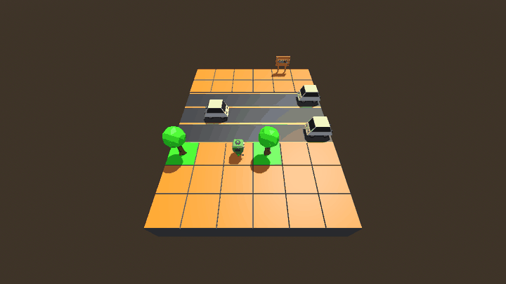

# Godot RL Cross The Road: 3D Autonomous AI with PPO & Native ONNX Deployment

[](https://godotengine.org)
[](https://www.python.org/)
[](https://stable-baselines3.readthedocs.io/)
[](https://onnx.ai/)
[](license.md)

A production-ready 3D Reinforcement Learning benchmark environment built in **Godot 4** and trained with **Proximal Policy Optimization (PPO)** using [Godot RL Agents](https://github.com/edbeeching/godot_rl_agents) and [Stable-Baselines3](https://github.com/DLR-RM/stable-baselines3).

The trained policy is exported directly into a self-contained **ONNX neural network model** (`model.onnx`, ~40 KB) that runs natively inside Godot at **sub-0.05 ms latency** without requiring Python, PyTorch, or GPU drivers in consumer game builds!

---

## 🎮 Autonomous In-Engine Inference in Action



*Figure 1: Standalone in-engine ONNX inference running live in Godot 4. The robot monitors oncoming vehicles in real time, holds position on safe sidewalk buffers, and dashes across moving traffic to the goal.*

---

## ⚡ Live Multi-Worker PPO Training


*Figure 2: Distributed parallel rollout workers exploring traffic lanes concurrently with real-time resets, distance reward shaping, and trial-and-error exploration.*

---

## 🧠 Neural Network Architecture & Parameter Breakdown

The agent is powered by a high-efficiency **Multi-Layer Perceptron (MLP)** Actor-Critic network. During production export, the Critic network is stripped, leaving only the feedforward Actor graph for ultra-fast in-game execution:

```
[Input Vector: 78 features]
          │
          ▼
   [Dense: 78 -> 64] ─── (4,992 weights + 64 biases = 5,056 params)
          │
          ▼
       [Tanh]
          │
          ▼
   [Dense: 64 -> 64] ─── (4,096 weights + 64 biases = 4,160 params)
          │
          ▼
       [Tanh]
          │
          ▼
   [Dense: 64 -> 5]  ─── (320 weights + 5 biases = 325 params)
          │
          ▼
[5 Action Logits: Left, Right, Forward, Backward, Idle]
```

### High-Level Specifications

| Metric | In-Engine Inference (`model.onnx`) | Training Model (`trained_model.zip`) |
| :--- | :--- | :--- |
| **Network Type** | Feed-Forward MLP (Actor only) | Actor-Critic MLP (`MultiInputActorCriticPolicy`) |
| **Input Shape** | `[batch_size, 78]` | `[batch_size, 78]` |
| **Output Shape** | `[batch_size, 5]` (action logits) | Action Distribution + State Value scalar |
| **Total Parameters** | **9,541 parameters** | **18,822 parameters** |
| **Model Size on Disk**| **~40 KB** (self-contained) | **~258 KB** |
| **Inference Latency** | **< 0.05 ms** (CPU) | N/A (Python training) |

### Observation & Action Spaces

* **Observation Space (78 floats)**:
  * 3 spatial rows (2 in front of player, 1 current row) $\times$ 13 columns (6 left, current, 6 right) = **39 grid tiles**.
  * Each tile provides **2 features**: `[traffic_direction, tile_or_car_type]`.
  * $39 \times 2 = \mathbf{78\text{ inputs}}$.
* **Action Space (Discrete 5)**:
  * `0`: Move Left ($\\leftarrow$)
  * `1`: Move Right ($\\rightarrow$)
  * `2`: Move Forward ($\\uparrow$)
  * `3`: Move Backward ($\\downarrow$)
  * `4`: Stay Still / Idle ($\\odot$)

---

## 🚀 Quickstart: Running the Pretrained Model in Godot

You can run the trained model immediately without installing Python or PyTorch:

1. Open this repository folder in **Godot 4.2+ (with .NET / C# support)**.
2. Press **Play (F5)** (the default scene is set to `res://scenes/onnx_inference_scene.tscn`).
3. The robot will autonomously navigate through traffic and reach the goal repeatedly using the bundled `model.onnx`!

---

## 🛠️ Training Your Own Agent

### 1. Python Environment Setup

We recommend Python 3.10 to 3.12:

```bash
# Clone the repository
git clone https://github.com/<your-username>/godot-rl-cross-the-road.git
cd godot-rl-cross-the-road

# Create virtual environment
python -m venv venv
# Windows:
venv\Scripts\activate
# Linux/macOS:
source venv/bin/activate

# Install dependencies
pip install -r requirements.txt
```

### 2. Launch Training

You can train using a Godot executable:

```bash
python train.py --env_path "<PATH_TO_GODOT_CONSOLE_EXE>" --speedup 8 --timesteps 50000 --save_model_path trained_model --onnx_export_path model.onnx
```

* **`--speedup 8`**: Runs physics simulation 8x faster than real-time.
* **`--timesteps 50000`**: Trains the policy for 50k environment steps (~2 minutes).
* **`--onnx_export_path model.onnx`**: Automatically exports and patches the trained model to ONNX IR Version 9.

---

## 💡 Key Technical Insights

### 1. ONNX IR Version 9 Compatibility
Modern PyTorch (2.4+) exports ONNX files with **IR Version 10** by default. Godot's C# OnnxRuntime (`Microsoft.ML.OnnxRuntime`) supports up to **IR Version 9**. 

`train.py` includes an automated post-export hook that converts the model to IR Version 9 and embeds all weights in a self-contained file:
```python
import onnx
m = onnx.load("model.onnx", load_external_data=True)
m.ir_version = 9
onnx.save(m, "model.onnx", save_as_external_data=False)
```

### 2. Potential-Based Distance Shaping
To avoid the sparse reward problem (wandering without finding the goal), the agent is rewarded with:
$$\\Delta R = \frac{d_{\\text{previous}} - d_{\\text{current}}}{10.0}$$
tracking the monotonic best distance to the goal line to eliminate oscillation exploits.

---

## 📁 Repository Structure

```
.
├── addons/godot_rl_agents/  # Godot RL Agents C# and GDScript runtime bridge
├── assets/                  # 3D models (robot, cars, tiles), materials, textures
├── docs/
│   ├── .gdignore            # Tells Godot to ignore docs media from resource importing
│   └── media/               # Animated demonstration GIFs
│       ├── inference_stage.gif
│       └── training_stage.gif
├── scenes/
│   ├── car.tscn             # Moving vehicle obstacle scene
│   ├── game_scene.tscn      # Base game layout (Map + Robot + CarManager)
│   ├── onnx_inference_scene.tscn # Standalone in-engine inference scene (Default Main Scene)
│   ├── robot.tscn           # Player robot with AIController3D
│   ├── tile.tscn            # Grid tile renderer (grass, road, tree, goal)
│   └── training_scene.tscn  # Vectorized multi-agent training scene
├── scripts/
│   ├── car.gd               # Car physics and screen wrapping
│   ├── car_manager.gd       # Traffic lane manager
│   ├── grid_map.gd          # Procedural grid generation and tile mapping
│   ├── robot.gd             # Player physics, movement, and collision handling
│   ├── robot_ai_controller.gd # 78-dim observation packing and 5-dim action dispatch
│   └── tile.gd              # Tile mesh variations
├── model.onnx               # Trained self-contained ONNX policy network (~40 KB)
├── project.godot            # Godot 4 project configuration file
├── requirements.txt         # Python dependencies for training
├── train.py                 # PPO training & automated ONNX export script
└── license.md               # MIT License
```

---

## 📜 License
MIT License. Inspired by [edbeeching/godot_rl_agents](https://github.com/edbeeching/godot_rl_agents).
